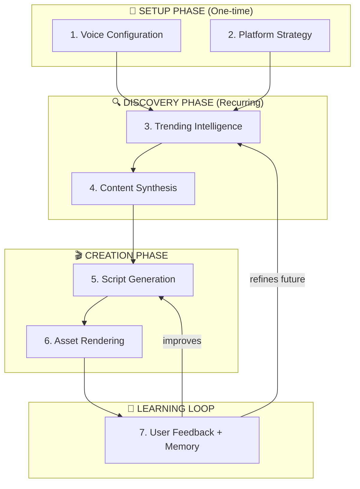
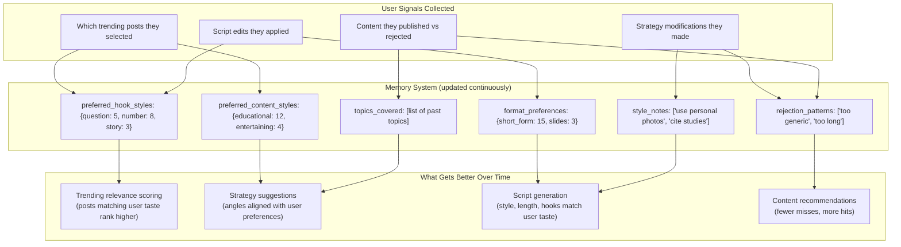
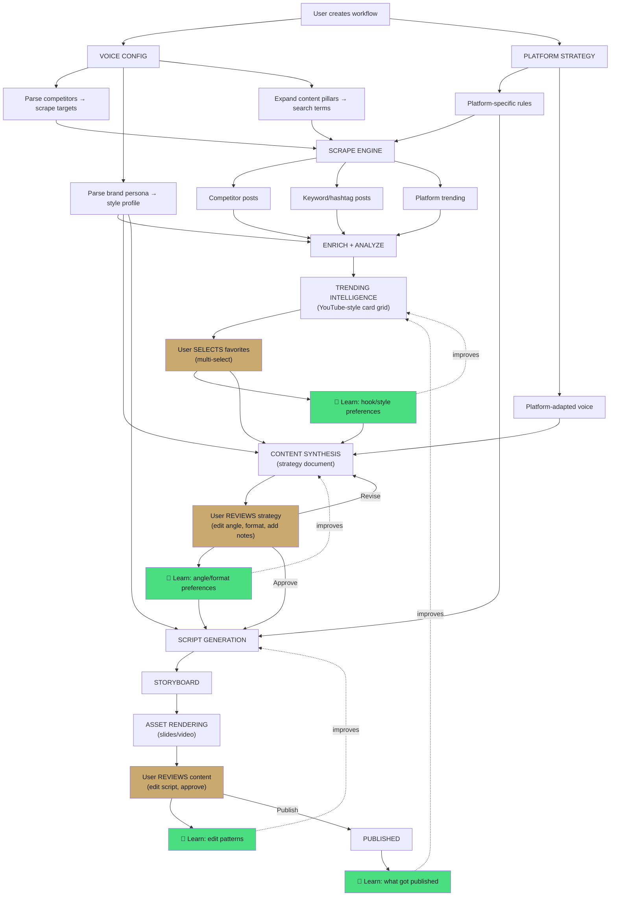

# Content Hub — Intended Generation Tree

> How the system **should** function based on your vision, mapped as a full execution tree with function signatures.

---

## The Big Picture



---

## 1. Voice Configuration (Setup)

### Current vs Intended

| Component | Current Behavior | Your Intended Behavior |
|---|---|---|
| **Competitors** | Stored in `workflows.competitors`, never read again | **Drives scraping** — system scrapes competitor accounts directly |
| **Brand Persona** | Stored as text in `brand_voice`, used only as tone in prompts | **Anticipates user needs** — parsed for preferences, style cues, and audience signals to guide scripting + storyboarding |
| **Content Pillars** | A list of topic tags, unused for scraping | **Researches the tag topics** for the performing content and builds the content strategy accordingly |

### Function Tree: Voice Processing

```
voice_config_pipeline(workflow_data)
│
├── parse_competitors(competitors_list: list[str])
│   │   Input:  ["@alexfitness", "@yogawithserena", "GymShark"]
│   │
│   ├── resolve_platform_handles(competitor: str) → dict
│   │   │   Turns "@alexfitness" into:
│   │   │   {
│   │   │     "tiktok": "alexfitness",
│   │   │     "youtube": "alexfitness",      ← may need lookup
│   │   │     "instagram": "alexfitness"
│   │   │   }
│   │   │
│   │   └── Returns: platform_accounts_map
│   │
│   ├── build_competitor_scrape_config(accounts_map) → dict
│   │   │   Output:
│   │   │   {
│   │   │     "tiktok":    { "profiles": ["alexfitness", "yogawithserena"] },
│   │   │     "youtube":   { "channels": ["alexfitness", "yogawithserena", "GymShark"] },
│   │   │     "instagram": { "profiles": ["alexfitness", "yogawithserena"] }
│   │   │   }
│   │   │
│   │   └── This gets MERGED with the hashtag-based config
│   │
│   └── Returns: competitor_scrape_config
│
├── parse_brand_persona(brand_voice_text: str) → BrandProfile
│   │   Input: "I create high-energy fitness content for 20-35 year olds.
│   │           I focus on home workouts. My style is motivational but 
│   │           grounded in science. I reference @alexfitness for energy
│   │           and @yogawithserena for calm transitions."
│   │
│   ├── extract_accounts(text) → list[str]
│   │   │   Returns: ["@alexfitness", "@yogawithserena"]
│   │   │   ⚠️ These get added to competitor scraping too
│   │   │
│   │   └── regex: r'@[\w.]+'
│   │
│   ├── extract_audience_signals(text) → AudienceProfile
│   │   │   Uses Gemini to extract:
│   │   │   {
│   │   │     "age_range": "20-35",
│   │   │     "interests": ["home workouts", "fitness"],
│   │   │     "pain_points": [],
│   │   │     "content_preferences": ["motivational", "science-based"]
│   │   │   }
│   │   │
│   │   └── This feeds into script personalization
│   │
│   ├── extract_style_markers(text) → StyleProfile
│   │   │   {
│   │   │     "energy": "high",
│   │   │     "tone": "motivational but grounded",
│   │   │     "transition_style": "calm",
│   │   │     "reference_creators": {"energy": "@alexfitness", "transitions": "@yogawithserena"}
│   │   │   }
│   │   │
│   │   └── This feeds into storyboard generation
│   │
│   └── Returns: BrandProfile(audience, style, mentioned_accounts)
│
├── process_content_pillars(pillars: list[str], descriptions: dict) → PillarConfig
│   │   Input: [
│   │     {"name": "Home Workouts", "desc": "No-equipment routines for small spaces"},
│   │     {"name": "Nutrition", "desc": "Meal prep and macro tracking for busy people"}
│   │   ]
│   │
│   ├── generate_search_terms(pillar) → list[str]
│   │   │   "Home Workouts" + desc → 
│   │   │   ["home workout", "no equipment workout", "apartment workout", 
│   │   │    "bodyweight fitness", "small space exercise"]
│   │   │
│   │   └── Uses Gemini to expand pillar into platform search terms
│   │
│   ├── build_pillar_scrape_config(search_terms) → dict
│   │   │   Merges with competitor config and hashtag config
│   │   │
│   │   └── Returns: combined Apify search config
│   │
│   └── Returns: PillarConfig(pillars, search_terms, scrape_config)
│
└── Returns: VoiceConfig(competitor_config, brand_profile, pillar_config)
```

> [!IMPORTANT]
> **Key difference from current**: Voice config is not passive storage — it's an **active processing step** that produces three actionable outputs: a scraping config, a brand profile, and pillar-based search terms. All three feed downstream.

---

## 2. Platform Strategy (Setup)

### Function Tree

```
platform_strategy_pipeline(platforms: list[str], voice_config: VoiceConfig)
│
├── for each platform in platforms:
│   │
│   ├── get_platform_rules(platform) → PlatformRules
│   │   │   Returns platform-specific best practices:
│   │   │   {
│   │   │     "tiktok": {
│   │   │       "ideal_length": "15-60s",
│   │   │       "hook_window": "0-3s",
│   │   │       "format": "vertical 9:16",
│   │   │       "best_practices": ["text overlay", "trending audio", "fast cuts"],
│   │   │       "content_types": ["short_form", "talking_head"],
│   │   │       "posting_windows": ["6-9am", "12-3pm", "7-11pm"]
│   │   │     },
│   │   │     "youtube": {
│   │   │       "ideal_length": "8-15min (long) or 30-60s (shorts)",
│   │   │       "hook_window": "0-5s",
│   │   │       "format": "16:9 landscape or 9:16 shorts",
│   │   │       "best_practices": ["strong thumbnail", "chapters", "end screen"],
│   │   │       "content_types": ["slides", "talking_head", "topic"],
│   │   │       "posting_windows": ["2-4pm weekdays"]
│   │   │     }
│   │   │   }
│   │   │
│   │   └── Stored knowledge base, not generated
│   │
│   ├── adapt_voice_to_platform(voice_config, platform_rules) → PlatformVoice
│   │   │   Adjusts the brand persona's style for each platform:
│   │   │   - TikTok: shorter hooks, more casual, trending audio cues
│   │   │   - YouTube: longer form, stronger CTAs, SEO-focused titles
│   │   │   - Instagram: visual-first, carousel storytelling, hashtag strategy
│   │   │   - LinkedIn: professional tone, data-driven, thought leadership
│   │   │
│   │   └── Uses Gemini to generate platform-specific voice adaptation
│   │
│   └── build_platform_scrape_weights(platform, pillars) → dict
│       │   How much to weight each pillar's search terms per platform
│       │   TikTok might weight "trending" higher, YouTube weights "educational"
│       │
│       └── Returns: {pillar: weight} for this platform
│
└── Returns: PlatformStrategy(
        platforms_rules: dict,
        platform_voices: dict,
        scrape_weights: dict
    )
```

---

## 3. Trending Intelligence (Discovery)

### Current → Intended visual change

```
CURRENT: Flat list

  ┌──────────────────────────────────────────────────────────────────┐
  │ [TIKTOK]  @creator_0  Mock trending post #0      👁 10,000  85 │
  │ [TIKTOK]  @creator_1  Mock trending post #1      👁 20,000  90 │
  │ [YOUTUBE] @creator_2  Mock trending post #2      👁 30,000  95 │
  └──────────────────────────────────────────────────────────────────┘

INTENDED: YouTube-style card grid with thumbnails

  ┌─────────────────┐  ┌─────────────────┐  ┌─────────────────┐
  │ ┌─────────────┐ │  │ ┌─────────────┐ │  │ ┌─────────────┐ │
  │ │  THUMBNAIL  │ │  │ │  THUMBNAIL  │ │  │ │  THUMBNAIL  │ │
  │ │   (image)   │ │  │ │   (image)   │ │  │ │   (image)   │ │
  │ └─────────────┘ │  │ └─────────────┘ │  │ └─────────────┘ │
  │ Why home work-  │  │ 5 meals under   │  │ Morning routine │
  │ outs beat gym   │  │ 500 calories    │  │ that changed... │
  │                 │  │                 │  │                 │
  │ @alexfitness    │  │ @mealprep_pro   │  │ @yogawithserena │
  │ 🔥 125K views   │  │ 🔥 89K views    │  │ 🔥 201K views   │
  │ [☐ Select]      │  │ [☑ Selected]    │  │ [☐ Select]      │
  └─────────────────┘  └─────────────────┘  └─────────────────┘
    
  Clicking a card → expands to detail panel:
  ┌──────────────────────────────────────────────────────────────┐
  │  "5 meals under 500 calories" — @mealprep_pro               │
  │                                                              │
  │  WHY THIS WORKS:                                             │
  │  • Hook: Number-based listicle creates curiosity             │
  │  • Format: Quick cuts with text overlay (avg 2s per clip)    │
  │  • Engagement: 89K views, 4.2% engagement rate              │
  │  • Audience overlap: 78% match with your target demo         │
  │                                                              │
  │  CONTENT STYLE BREAKDOWN:                                    │
  │  • Type: Educational + Practical                             │
  │  • Hook style: "Number + promise" pattern                    │
  │  • Pacing: Fast (15 cuts in 30s)                             │
  │  • CTA: "Save this for later" (drives saves metric)         │
  │                                                              │
  │  [☑ Use as inspiration]        [View original ↗]            │
  └──────────────────────────────────────────────────────────────┘
```

### Function Tree: Trending Intelligence

```
trending_intelligence_pipeline(workflow_id, voice_config, platform_strategy)
│
├── scrape_all_sources(workflow_id, voice_config, platform_strategy)
│   │
│   ├── scrape_competitors(competitor_config) → list[ScrapedPost]
│   │   │   Scrapes ACTUAL competitor accounts (not just hashtags)
│   │   │   For each competitor → get their last 20 posts
│   │   │
│   │   ├── apify_scrape_profile(platform, username) → list[RawPost]
│   │   └── normalize_post(raw, platform) → ScrapedPost
│   │
│   ├── scrape_pillar_keywords(pillar_config) → list[ScrapedPost]
│   │   │   Uses expanded search terms from pillars
│   │   │
│   │   ├── apify_scrape_hashtags(platform, hashtags) → list[RawPost]
│   │   └── normalize_post(raw, platform) → ScrapedPost
│   │
│   ├── scrape_trending_general(platform) → list[ScrapedPost]
│   │   │   Platform-wide trending in the niche
│   │   │
│   │   └── Uses platform's trending/discover APIs
│   │
│   └── deduplicate_and_merge(all_posts) → list[ScrapedPost]
│
├── enrich_posts(posts: list[ScrapedPost], brand_profile) → list[EnrichedPost]
│   │
│   ├── for each post:
│   │   │
│   │   ├── fetch_thumbnail(post.url) → thumbnail_url
│   │   │   │   Extracts or downloads the thumbnail image
│   │   │   └── Stores in Supabase Storage
│   │   │
│   │   ├── analyze_why_it_works(post, brand_profile) → ContentAnalysis
│   │   │   │   Uses Gemini to analyze:
│   │   │   │   {
│   │   │   │     "hook_type": "number + promise",
│   │   │   │     "content_style": "educational + practical",
│   │   │   │     "pacing": "fast (15 cuts/30s)",
│   │   │   │     "engagement_drivers": ["curiosity gap", "save-worthy"],
│   │   │   │     "audience_overlap_score": 0.78,
│   │   │   │     "why_it_works": "Number-based listicle creates curiosity...",
│   │   │   │     "applicable_techniques": ["number hook", "quick cuts", "text overlay"]
│   │   │   │   }
│   │   │   │
│   │   │   └── Compares post style against user's brand_profile
│   │   │
│   │   ├── compute_relevance_score(post, brand_profile, pillars) → float
│   │   │   │   Weighted score:
│   │   │   │   - 40% content/pillar match
│   │   │   │   - 30% organic engagement metrics
│   │   │   │   - 20% audience overlap
│   │   │   │   - 10% recency
│   │   │   │
│   │   │   └── Replaces the current simple organic_score
│   │   │
│   │   └── Returns: EnrichedPost(post + thumbnail + analysis + relevance)
│   │
│   └── sort_by_relevance(enriched_posts) → list[EnrichedPost]
│
├── store_in_db(enriched_posts) → None
│   │   Stores to trending_content with all enrichment data
│   │   Including thumbnail_url and content_analysis JSON
│   │
│   └── Also embeds in pgvector for RAG retrieval
│
└── Returns: list[EnrichedPost]  (served to frontend as card grid)
```

### User Interaction Model

```
user_selects_trending(user_id, workflow_id, selected_post_ids: list[str])
│
├── record_user_preference(workflow_id, selected_posts)
│   │   Stores which posts the user found interesting
│   │   Updates the learning memory:
│   │   {
│   │     "preferred_hook_styles": {"number_hook": 3, "question": 1, ...},
│   │     "preferred_content_styles": {"educational": 5, "entertaining": 2},
│   │     "preferred_pacing": {"fast": 4, "slow": 1},
│   │     "liked_creators": ["@alexfitness", "@mealprep_pro"],
│   │     "selection_history": [
│   │       {"post_id": "...", "selected_at": "...", "analysis": {...}}
│   │     ]
│   │   }
│   │
│   └── This is the LEARNING signal — system gets better each time
│
├── extract_common_patterns(selected_posts) → InspirationPattern
│   │   Finds what's common across the user's selections:
│   │   {
│   │     "dominant_hook": "number + promise",
│   │     "dominant_style": "educational",
│   │     "avg_pacing": "fast",
│   │     "common_techniques": ["text overlay", "quick cuts"],
│   │     "topic_clusters": ["home fitness", "nutrition"]
│   │   }
│   │
│   └── This feeds into Content Synthesis
│
└── Returns: InspirationPattern → passed to Content Synthesis
```

---

## 4. Content Synthesis (Strategy Review)

### What this should be (vs what currently exists)

```
CURRENT "Content Synthesis" tab:
  - Shows a list of AI-suggested topics
  - User can click "Draft Script →" to jump to generation
  - ❌ No user input, no strategy review, no learning

INTENDED Content Synthesis:
  - Takes the user's SELECTED trending posts
  - Generates a STRATEGY DOCUMENT the user can review
  - User can modify, redirect, approve
  - System LEARNS from every modification
```

### Function Tree: Content Synthesis

```
content_synthesis_pipeline(
    workflow_id,
    selected_posts: list[EnrichedPost],
    inspiration_pattern: InspirationPattern,
    voice_config: VoiceConfig,
    platform_strategy: PlatformStrategy
)
│
├── generate_strategy_document(inputs) → StrategyDocument
│   │   Uses Gemini to synthesize everything into a strategy:
│   │
│   │   Output structure:
│   │   {
│   │     "content_angle": "5 home workouts that replaced my gym membership",
│   │     "why_this_angle": "Combines your 'home workout' pillar with the 
│   │                        'number listicle' hook pattern that your selected 
│   │                        posts had 3.5x avg engagement",
│   │     "target_platform": "tiktok",
│   │     "recommended_format": {
│   │       "type": "short_form",
│   │       "length": "30-45s",
│   │       "hook_style": "number + personal story",
│   │       "pacing": "fast cuts with text overlay",
│   │       "cta_style": "save + follow"
│   │     },
│   │     "inspired_by": [
│   │       {"post": "5 meals under 500cal", "technique_borrowed": "number hook"},
│   │       {"post": "Morning routine...", "technique_borrowed": "day-in-life pacing"}
│   │     ],
│   │     "differentiation": "Unlike the inspiration posts which focus on 
│   │                         generic fitness, yours ties directly to your 
│   │                         'science-based' brand angle",
│   │     "estimated_performance": {
│   │       "view_range": "15K-45K",
│   │       "engagement_rate": "3.5-5%",
│   │       "confidence": 0.72
│   │     }
│   │   }
│   │
│   └── This is the STRATEGY the user reviews — NOT a final script
│
├── present_to_user(strategy: StrategyDocument) → UserFeedback
│   │
│   │   UI shows the strategy as an editable review card:
│   │
│   │   ┌────────────────────────────────────────────────────────┐
│   │   │  📋 CONTENT STRATEGY                                  │
│   │   │                                                        │
│   │   │  ANGLE: "5 home workouts that replaced my gym"         │
│   │   │  [✏️ edit]                                              │
│   │   │                                                        │
│   │   │  WHY THIS ANGLE:                                       │
│   │   │  Combines your 'home workout' pillar with the          │
│   │   │  number listicle pattern (3.5x avg engagement)         │
│   │   │                                                        │
│   │   │  FORMAT:                                                │
│   │   │  ○ Short-form (30-45s)  ← you can change this         │
│   │   │  ○ Hook: number + personal story                       │
│   │   │  ○ Pacing: fast cuts with text overlay                 │
│   │   │                                                        │
│   │   │  INSPIRED BY:                                          │
│   │   │  • "5 meals under 500cal" → number hook               │
│   │   │  • "Morning routine..." → day-in-life pacing          │
│   │   │                                                        │
│   │   │  YOUR UNIQUE SPIN:                                     │
│   │   │  Science-based angle differentiates from generic       │
│   │   │  fitness content                                       │
│   │   │                                                        │
│   │   │  ────────────────────────────────────────              │
│   │   │  💬 YOUR NOTES:                                        │
│   │   │  ┌──────────────────────────────────────────┐          │
│   │   │  │ "Make it more personal, use my actual    │          │
│   │   │  │  transformation photos"                   │          │
│   │   │  └──────────────────────────────────────────┘          │
│   │   │                                                        │
│   │   │  [← Revise Strategy]     [✅ Approve & Generate →]    │
│   │   └────────────────────────────────────────────────────────┘
│   │
│   └── Returns: UserFeedback(approved, modifications, notes)
│
├── learn_from_feedback(workflow_id, strategy, user_feedback)
│   │   Records what the user changed:
│   │   - Did they change the angle? → update topic preferences
│   │   - Did they change the format? → update format preferences  
│   │   - Did they add notes? → extract style cues for future
│   │   - Did they reject entirely? → learn what NOT to suggest
│   │
│   ├── update_publication_memory(workflow_id, learnings)
│   │   │   Accumulates over time:
│   │   │   {
│   │   │     "angle_preferences": {"listicle": +1, "story": 0, ...},
│   │   │     "format_overrides": {"prefers_shorter": true},
│   │   │     "recurring_notes": ["use personal photos", "more science"],
│   │   │     "rejection_patterns": ["too generic", "too long"]
│   │   │   }
│   │   │
│   │   └── This is fed back into future strategy generation
│   │
│   └── update_style_profile(workflow_id, feedback)
│
├── if approved:
│   └── pass_to_generation(strategy, user_notes) → triggers Step 5
│
├── if "Revise Strategy":
│   └── regenerate_strategy_document(inputs + feedback) → loop back
│
└── Returns: ApprovedStrategy (ready for script generation)
```

---

## 5. Script Generation (Creation)

### Function Tree

```
script_generation_pipeline(
    approved_strategy: ApprovedStrategy,
    voice_config: VoiceConfig,
    platform_strategy: PlatformStrategy,
    user_memory: PublicationMemory
)
│
├── build_enriched_prompt(all_inputs) → str
│   │   Combines:
│   │   - Approved strategy (angle, format, inspiration sources)
│   │   - User's notes/modifications from synthesis review
│   │   - Brand persona (style, tone, audience)
│   │   - Platform-specific rules (length, format, best practices)
│   │   - Few-shot examples from RAG (similar published scripts)
│   │   - Topics to AVOID (from memory)
│   │   - User's known preferences (hook style, pacing, length)
│   │
│   └── This prompt is MUCH richer than current "topic + brand_voice"
│
├── generate_script(prompt) → ScriptResult
│   │   Gemini generates the script
│   │   With Anthropic fallback
│   │
│   └── Returns: {script, model_used}
│
├── generate_storyboard(script, platform_rules, brand_profile)
│   │   Creates visual/editorial storyboard:
│   │   - Shot list with timing
│   │   - Text overlay content + positioning
│   │   - Transition types
│   │   - Audio cues (if applicable)
│   │   - Thumbnail concept
│   │
│   └── Returns: Storyboard
│
├── render_assets(storyboard, content_type)
│   │   Playwright for slides, Remotion for video
│   │
│   └── Returns: list[asset_urls]
│
└── present_for_review(script, storyboard, assets)
    │   User sees the generated content and can:
    │   - Edit the script (side-by-side editor — already exists)
    │   - Approve for publishing
    │   - Request regeneration with notes
    │
    └── Any edits feed back into the learning loop (Step 7)
```

---

## 6. The Learning Loop



---

## Full End-to-End: How It All Connects



> [!IMPORTANT]
> **The gold nodes are USER DECISION POINTS** — places where the user actively shapes the output. The green nodes are LEARNING MOMENTS — where the system captures preferences. The current system has **zero** user decision points between "type a topic" and "see the result." Your vision adds **three**.
