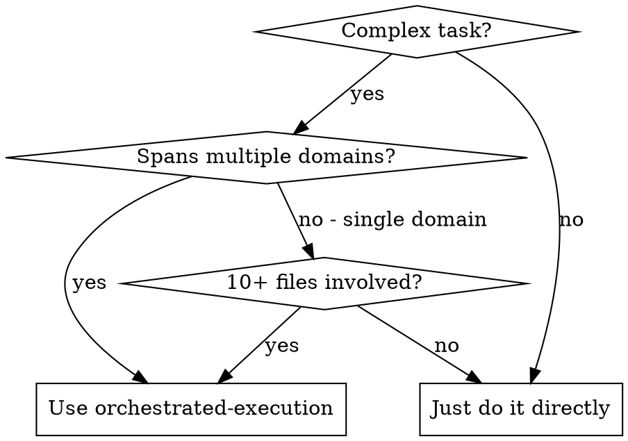

# Orchestrated Execution

## Overview

You are the **advisor** (Opus). You decompose a complex task into focused subtasks, assign each to a specialist domain, prevent file conflicts, order execution chronologically, and dispatch **executor agents** (Sonnet or Haiku) to do the work. Executors have full filesystem tools. You provide strategic guidance when they get stuck.

This skill combines the **dispatching-parallel-agents** pattern (independent agents, no shared state) with an **advisor layer** (you plan, you intervene, you verify).

**Announce at start:** "I'm using orchestrated-execution to decompose and dispatch this task."

## State Persistence (required)

Every orchestration writes a state file to `Content-Hub-Vault/00-Management/Orchestrations/YYYY-MM-DD_<slug>.md` at the end of Phase 2, and updates its frontmatter status field at each phase transition (`awaiting-approval` → `approved` → `executing` → `complete`). This file is the recovery anchor: if context compacts mid-run, the user invokes `/resume-orchestration`, which reads the state file and picks up from the recorded phase. Without this file, the orchestration cannot be resumed and the work done so far is lost.

## When to Use



**Use when:**
- User invokes `/orchestrate` or `/delegate`
- Task spans 2+ specialist domains from AGENTS.md
- Task touches 10+ files across different subsystems
- Building a full feature end-to-end (schema + API + UI)

**Don't use when:**
- Single-domain task (just dispatch one agent directly)
- Bug fix in one file (just fix it)
- Exploratory work where you don't know what's broken yet (use systematic-debugging)

---

## The Process

### Phase 1: Recon

**MANDATORY BLOCKING STEP — You MUST dispatch a Haiku recon agent BEFORE reading any files inline or doing any planning.**

```
Agent(subagent_type="Explore", model="haiku", description="Recon for orchestration", prompt="
  Scan these areas of the codebase and report:
  1. What files exist in [relevant directories]
  2. Key imports and dependencies between files
  3. Existing patterns (naming, structure, conventions)
  4. Any shared types or interfaces that multiple files depend on
  Report file paths and brief descriptions. Be thorough but fast.
")
```

**Why Haiku, not inline reads:** Opus context is expensive and limited. Haiku returns structured file summaries at a fraction of the token cost, preserving your Opus budget for the planning and oversight work in Phases 2–6. Every inline Glob/Read/Grep you do here instead burns that budget unnecessarily.

**Performing inline recon (Glob, Read, Grep) before dispatching this agent is a protocol violation.** If you catch yourself reaching for a file-reading tool before the recon agent has returned, stop and dispatch the agent first.

Wait for the recon agent to return its findings before proceeding to Phase 2.

Then read `Content-Hub-Vault/00-Management/Plans/AGENTS.md` to load the 6 specialist definitions:
- **pipeline-agent** — content generation pipeline
- **research-agent** — research layer and RAG
- **intelligence-agent** — learning loops and suggestions
- **frontend-agent** — Next.js UI
- **db-agent** — Supabase schema and RLS
- **brand-agent** — brand config and visual identity

### Phase 2: Plan

Using recon findings + AGENTS.md, decompose the task.

#### Task decomposition rules

1. **One specialist per task.** Every task maps to exactly one agent from AGENTS.md. If work spans two domains, split it into two tasks.

2. **One task per file.** No two tasks in the same execution group may modify the same file. This is the iron law that prevents conflicts.

3. **Focused scope.** Each task should be completable by an agent without needing context from other parallel tasks. If task B needs the output of task A, they go in different groups.

4. **Clear acceptance criteria.** Every task must state what "done" looks like. The agent needs to know when to stop.

#### File conflict prevention

Use AGENTS.md domain boundaries as the primary mechanism:
- `pipeline-agent` owns `backend/content/*`
- `research-agent` owns `backend/research/*`
- `intelligence-agent` owns `backend/intelligence/*`, `backend/scheduler/*`
- `frontend-agent` owns `frontend/app/*`, `frontend/components/*`, `frontend/lib/*`
- `db-agent` owns `supabase/migrations/*`
- `brand-agent` owns `backend/brand/*`

**Shared files** (e.g., `frontend/lib/types.ts`, `backend/main.py`) get assigned to ONE task. All other tasks that need those changes must wait in a later group.

#### Execution ordering

Group truly independent tasks for parallel dispatch. Order groups chronologically:

1. **Schema/DB first** — migrations, table creation
2. **Backend second** — API endpoints, models, business logic
3. **Frontend third** — pages, components, API client wiring
4. **Cross-cutting last** — tests, integration, config

Dependencies flow downward only: a task in group N can depend on groups 1..N-1 but never on tasks in its own group.

#### Plan output format

Present the plan to the user as:

```
## Execution Plan: [Task Title]

**Tasks:** [count] across [count] groups
**Specialists:** [list of involved agents]

### Group 1 (parallel)
- [db-agent | EASY] Create migration for X table
  Files: supabase/migrations/006_x.sql
  Criteria: Table exists with correct columns and RLS

- [brand-agent | EASY] Add Y field to brand config
  Files: backend/brand/models.py
  Criteria: BrandConfig model includes Y field

### Group 2 (depends on Group 1)
- [pipeline-agent | MEDIUM] Wire X table into pipeline
  Files: backend/content/router.py, backend/content/storyboard.py
  Criteria: Pipeline reads from X table, storyboard includes new data

### Group 3 (parallel, depends on Group 2)
- [frontend-agent | MEDIUM] Build X management page
  Files: frontend/app/x/page.tsx, frontend/lib/api.ts, frontend/lib/types.ts
  Criteria: Page renders, API calls work, types defined

- [intelligence-agent | EASY] Add X to learning loop
  Files: backend/intelligence/memory.py
  Criteria: Publication memory captures X data
```

#### Persist the plan to disk (required before Phase 3)

Before presenting the plan to the user, **write it to a state file** at:

```
Content-Hub-Vault/00-Management/Orchestrations/YYYY-MM-DD_<slug>.md
```

The slug is a short kebab-case summary of the task (e.g. `phase4-ab-testing-frontend`). Use today's date.

The file format is:

```markdown
---
slug: <slug>
created: <YYYY-MM-DD>
status: awaiting-approval
current_group: null
groups_complete: []
specialists_involved: [<comma-separated agent names from AGENTS.md>]
---

# Orchestration: <human-readable title>

## Recon summary
<3–8 bullet points — the findings from Phase 1 that this plan depends on. Include file paths.>

## Execution plan
<The exact plan block as shown to the user below — groups, tasks, complexity, files, acceptance criteria.>

## Agent prompts
<One section per task. Each section contains the exact prompt text to pass to Agent(...) at Phase 4.
Use the subagent prompt template from Phase 4 below. Leave a `{SPECIALIST_DEFINITION}` placeholder
where the AGENTS.md specialist section will be spliced in at dispatch time.>

### Task: <specialist>: <task title>
- description: "<specialist>: <task title>"
- model: sonnet | haiku
- prompt: |
    You are the {specialist_agent} for the Content Hub project.

    {SPECIALIST_DEFINITION}

    ## Your Task
    <task description>

    ## Scope
    Read for context: <files>
    Modify: <files>
    Create: <files>

    IMPORTANT: Only touch the files listed above. Other agents are working on other
    files in parallel. Modifying anything outside your scope WILL cause conflicts.

    ## Acceptance Criteria
    <numbered list>

    ## When done
    Report your status:
    - DONE: All criteria met
    - DONE_WITH_CONCERNS: Complete but you have doubts (explain)
    - STUCK: Cannot proceed (explain what blocks you)
    - NEEDS_CONTEXT: Need information not provided (specify what)

    Include a summary of what you changed and why.

## Status log
- <YYYY-MM-DD HH:MM> created, status=awaiting-approval
```

**Why this matters:** If context compacts between Phase 3 and Phase 4, the plan is gone from chat but preserved on disk. The `/resume-orchestration` skill can re-load this file and continue from wherever we left off.

### Phase 3: Approve

**Wait for user approval before executing.** Show the plan and ask explicitly. The user may:
- Approve as-is
- Adjust task assignments or ordering
- Remove or add tasks
- Change complexity estimates

Do not proceed until the user confirms.

**On approval**, update the state file: set `status: approved`, append `<timestamp> approved` to the status log. If the user asked for plan edits, update the Execution plan and Agent prompts sections before resuming the approve wait.

### Phase 4: Execute

Process groups sequentially. Within each group, dispatch tasks in parallel.

**Before dispatching the first group**, update the state file: set `status: executing`, `current_group: 1`, append a status-log line. Read `Content-Hub-Vault/00-Management/Plans/AGENTS.md` once to get the specialist definitions — you'll splice them into each agent prompt's `{SPECIALIST_DEFINITION}` placeholder at dispatch time.

#### Model selection

- **EASY** (single file, clear spec, mechanical): `model="haiku"`
- **MEDIUM** (2-3 files, some judgment): `model="sonnet"`
- **HARD** (complex logic, integration concerns): `model="sonnet"`

#### Subagent prompt template

For each task, dispatch an Agent with this structure:

```
Agent(
  description="[specialist]: [task title]",
  model="sonnet",  # or "haiku" for EASY
  prompt="
    You are the {specialist_agent} for the Content Hub project.

    {Paste the full specialist definition from AGENTS.md — role, owns, key rules, tools needed}

    ## Your Task
    {task description}

    ## Scope
    Read for context: {list of files to read first}
    Modify: {list of files to change}
    Create: {list of new files to create}

    IMPORTANT: Only touch the files listed above. Other agents are working
    on other files in parallel. Modifying anything outside your scope WILL
    cause conflicts.

    ## Acceptance Criteria
    {numbered list of criteria}

    ## When done
    Report your status:
    - DONE: All criteria met
    - DONE_WITH_CONCERNS: Complete but you have doubts (explain)
    - STUCK: Cannot proceed (explain what blocks you)
    - NEEDS_CONTEXT: Need information not provided (specify what)

    Include a summary of what you changed and why.
  "
)
```

#### Parallel dispatch

For groups with 2+ tasks, dispatch all agents in a **single message** with multiple Agent tool calls:

```
# All in one message — they run in parallel
Agent(description="db-agent: create X table", model="haiku", prompt="...")
Agent(description="brand-agent: add Y field", model="haiku", prompt="...")
```

For groups with 1 task, dispatch in the foreground (default).

### Phase 5: Handle Results

After each group completes, read every agent's summary.

#### DONE or DONE_WITH_CONCERNS
- Note the summary
- If concerns: evaluate whether they need action before proceeding
- Mark task complete and move to next group

#### STUCK
The agent cannot proceed. As the advisor:

1. **Read the stuck report carefully.** Understand what the agent tried and why it failed.
2. **Diagnose the root cause:**
   - Missing context? Provide it via SendMessage to the same agent.
   - Task too complex? Consider splitting it.
   - Wrong approach? Send strategic guidance via SendMessage.
   - Bug in existing code? May need to fix that first (add a new task).
3. **Send guidance via SendMessage** to continue the same agent (preserves working context):
   ```
   SendMessage(to="agent-id", message="
     The issue is [diagnosis]. Here's how to proceed:
     1. [specific guidance]
     2. [specific guidance]
     Try this approach and report back.
   ")
   ```
4. **Escape hatch:** If the agent has been through 2+ rounds of guidance and context is growing heavy, dispatch a **fresh agent** instead:
   ```
   Agent(description="[specialist]: continue [task]", model="sonnet", prompt="
     A previous agent started this task but got stuck. Here's what was done:
     {summary of completed work}

     Here's what remains:
     {remaining work + guidance}

     {same scope and acceptance criteria as original}
   ")
   ```

#### NEEDS_CONTEXT
The agent needs information. Provide it via SendMessage:
```
SendMessage(to="agent-id", message="
  Here's the context you need:
  {the information}
  Continue with your task.
")
```

### Phase 6: Verify

After ALL groups complete:

1. **Review every summary.** Ensure each task met its acceptance criteria.
2. **Check for scope violations.** Did any agent modify files outside its assigned list?
3. **Run tests** if applicable:
   - `pytest backend/tests/` for backend changes
   - `npx vitest run` for frontend changes
4. **Spot check.** Read 2-3 modified files to verify quality and consistency.
5. **Close out the state file.** Set `status: complete`, append a final status-log line.
5. **Report to user:**
   ```
   ## Orchestration Complete

   **Tasks completed:** X/Y
   **Agents used:** [list]
   **Files changed:** [count]

   ### Summary
   - [Group 1 results]
   - [Group 2 results]
   - [Group 3 results]

   ### Test results
   [pass/fail details]

   ### Concerns
   [any DONE_WITH_CONCERNS notes or issues found during verification]
   ```

---

## Common Mistakes

**Never:**
- Dispatch two agents that modify the same file in the same group
- Skip the recon agent dispatch or replace it with inline Glob/Read/Grep (protocol violation — wastes Opus context budget)
- Skip user approval (the plan may be wrong)
- Skip writing the state file before asking for approval (makes the run unrecoverable)
- Let a stuck agent spin for 3+ rounds without re-evaluating the decomposition
- Make tasks too large (agent loses focus, context bloats) or too small (overhead per agent call)
- Assume tasks are independent without checking file ownership
- Skip verification after all groups complete

**Always:**
- One specialist per task, one task per file (in parallel groups)
- Schema before backend before frontend
- Write the state file at Phase 2, update status at every phase transition
- Pass `model="haiku"` to the Phase 1 recon agent
- Show the plan, get approval, then execute
- Review every agent's summary before moving to the next group
- Run tests after integration

---

## Integration with Other Superpowers

This skill builds on and replaces parts of:

- **dispatching-parallel-agents** — This skill uses the same parallel dispatch pattern but adds advisor oversight, dependency ordering, and stuck-agent handling. For simple parallel debugging, dispatching-parallel-agents is still appropriate.
- **subagent-driven-development** — This skill uses a similar implementer-agent pattern but without the two-stage spec+code review (which adds significant overhead at 10+ task scale). For smaller, high-precision tasks, subagent-driven-development with its review gates may be more appropriate.

**Works alongside:**
- **using-git-worktrees** — Consider using worktrees for large orchestrations to isolate changes
- **verification-before-completion** — Use for the final verification phase
- **writing-plans** — If the task is so large it needs a written plan before even starting orchestration
