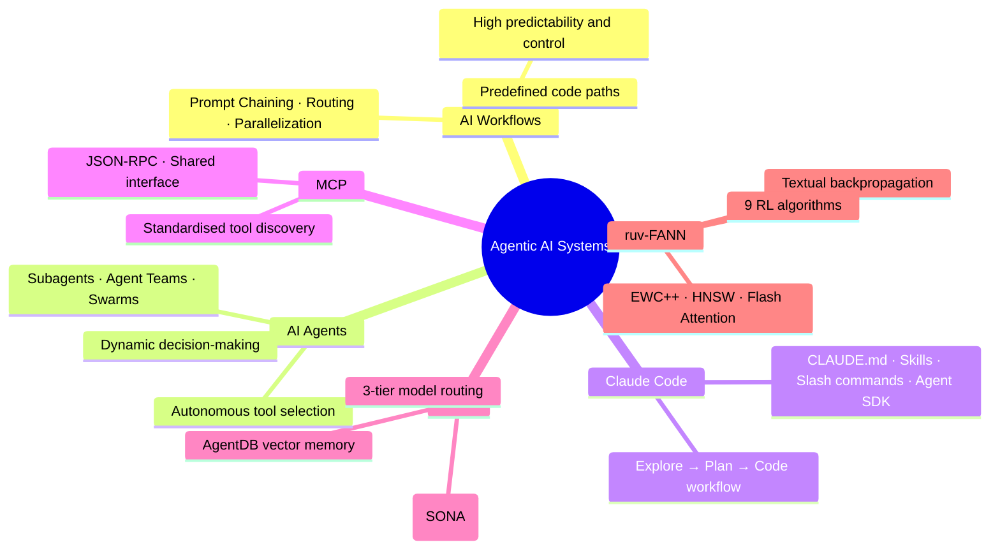

# ruflo — Skills, Agents, Slash Commands, Plugins & Architecture

> Full research handoff via NotebookLM deep research (109 sources). Raw artifacts in `10-Research/2026-05-06_ruflo/`.

---

## Executive Summary

The agentic AI landscape is built on four composable primitives inside Claude Code — **Skills**, **Agents/Subagents**, **Slash Commands**, and **Plugins** — unified by the **Model Context Protocol (MCP)**. ruflo (formerly claude-flow) is an orchestration platform that layers on top of Claude Code, coordinating 100+ specialised agents with self-learning routing, vector memory, and 3-tier model cost management.

---

## 1. Skills

**What:** Packages of procedural knowledge — the agent's Standard Operating Procedures (SOPs). Instruct Claude *how* to achieve a goal using available tools.

**File structure:**
```
.claude/skills/<name>/
└── SKILL.md    ← YAML frontmatter + markdown instructions
```

**Scope:** Project (`.claude/skills/`) or User (`~/.claude/skills/`).

**When to use:**
- Persistent domain knowledge (API conventions, team style guides, content procedures).
- Complex multi-stage workflows inside the main conversation context.
- Anything too domain-specific to live in `CLAUDE.md`.

**Best practices:**
- Keep `CLAUDE.md` broadly applicable only; push specifics into Skills.
- Use `disable-model-invocation: true` for workflows that should only trigger on explicit user command.
- A Skill without tools is useless; tools without Skill instructions are dangerous.

---

## 2. Agents / Subagents

**What:** Dynamic systems where an LLM directs its own processes. Subagents are specialised workers that spawn into their own isolated context windows.

**File structure:**
```
.claude/agents/<name>.md       ← Project scope
~/.claude/agents/<name>.md     ← User scope
```
Frontmatter: `name`, `description`, `tools`, `model`, `permissionMode`.

**Built-in subagents:**
| Name | Model | Role |
|------|-------|------|
| Explore | Haiku | Fast read-only codebase analysis |
| Plan | Sonnet | Research without making changes |
| General-purpose | Sonnet | Complex multi-step modifications |

**When to use:**
- Side tasks that would flood the main conversation (log analysis, heavy research, file-grepping).
- Any task where isolation is more important than shared context.

**Best practices:**
- Scope narrowly — one task per subagent.
- Protect the main context window; LLM performance degrades as it fills.
- Pass explicit notebook/artifact IDs (not shared context) in parallel workflows.

---

## 3. Slash Commands

**What:** Built-in session/context controls that execute in the harness, not inside Claude's reasoning loop.

| Command | Purpose |
|---------|---------|
| `/init` | Generates starter `CLAUDE.md` from build system analysis |
| `/clear` | Resets context window — use between unrelated tasks |
| `/rewind` | Restores conversation + code state to a previous checkpoint |
| `/agents` | Tabbed UI to manage, create, edit subagents |
| `/plugin` | Browse marketplace for installable skills, tools, integrations |
| `/btw` | Ask a question without it entering conversation history |
| `/fast` | Toggle fast mode |
| `/model` | Switch model mid-session |

**Custom slash commands:** Skills that expose a `/` trigger in their `SKILL.md` description become user-invocable slash commands (e.g., `/yt-pipeline`, `/cascade`, `/ideation`).

---

## 4. Plugins

**What:** Bundled units of skills, hooks, subagents, and MCP servers. Primary vehicle for community-built extensions.

**Install:** Via `/plugin` marketplace or `npx skills add <author>/<repo>`.

**When to use:** Ready-made integrations without manual config (e.g., code intelligence, database toolsets).

**Security:** Plugin-provided subagents may have restricted permissions vs. locally defined subagents.

---

## 5. Model Context Protocol (MCP)

**What:** Standardised JSON-RPC interface bridging LLMs to external data and tools. LLM-agnostic.

**Role:** MCP = the "Hands" (connectivity). Skills = the "Brain" (SOPs). Agents = the "Workers" (autonomous execution).

---

## Comparison Matrix

| Dimension | MCP | Skill | Subagent | Plugin |
|-----------|-----|-------|----------|--------|
| Analogy | Hands / Drivers | Brain / SOPs | Worker | Extension Pack |
| Primary role | Connectivity & tool access | Procedural workflow | Dynamic task execution | Bundle delivery |
| Persistence | Server process | Model context + sandbox | Isolated context window | Installed package |
| Logic type | Atomic actions (API call, SQL) | Complex multi-step logic | Autonomous decision-making | N/A (container) |
| Defined in | MCP config | `.claude/skills/*/SKILL.md` | `.claude/agents/*.md` | Marketplace |

**Decision rules:**
- Need **connectivity** (private GitHub, Supabase DB) → **MCP**
- Need a **specific behaviour / procedure** → **Skill**
- Need **isolated research** without flooding main context → **Subagent**
- Need a **ready-made community toolset** → **Plugin**

---

## 6. ruflo Architecture

`ruflo` orchestrates Claude Code into a parallel, self-learning multi-agent platform.

**Four-layer stack:**
```
┌──────────────────────────────┐
│ 1. USER LAYER                │  CLI / Claude Code UI
├──────────────────────────────┤
│ 2. ORCHESTRATION LAYER       │  MCP Servers · Routers · Hooks
├──────────────────────────────┤
│ 3. AGENT LAYER               │  100+ specialised types
│                              │  Coder · Tester · Security · Researcher
├──────────────────────────────┤
│ 4. PROVIDER LAYER            │  Anthropic · OpenAI · Local (Llama)
└──────────────────────────────┘
```

**3-tier model routing** (~75% API cost reduction claim):
| Tier | Model | Used for |
|------|-------|---------|
| Fast | Haiku | Routine, repetitive tasks |
| Standard | Sonnet | General development |
| Deep | Opus | Architecture, complex reasoning |

---

## 7. ruv-FANN — The Intelligence Layer

`ruv-FANN` (Framework for Algorithmic Artificial Neural Networks) provides self-optimising capabilities for ruflo.

| Component | Role |
|-----------|------|
| **SONA** | Self-Optimising Pattern Learning — learns optimal routing from live performance |
| **EWC++** | Elastic Weight Consolidation — prevents catastrophic forgetting of past patterns |
| **Flash Attention** | High-performance context processing |
| **HNSW** | Sub-millisecond nearest-neighbour vector search for AgentDB |
| **SemanticRouter** | Cosine-similarity intent routing |
| **AgentDB** | Persistent vector memory store across sessions |
| **9 RL Algorithms** | Q-Learning, PPO, DQN + 6 more for continuous agent improvement |

---

## Key Quotes

> "Claude's context window fills up fast, and performance degrades as it fills... The context window is the most important resource to manage." — Claude Code Docs

> "Use a workflow when you can define every step in advance; use an agent when the steps themselves depend on what you find along the way." — Reddit/AI_Agents

> "A Skill is useless without tools; tools are dangerous without instructions." — Verdent Guides

---

## Actionable Best Practices

1. **Verification gates** — always give Claude test cases or success criteria to verify its own work.
2. **Explore → Plan → Implement → Commit** loop — plan mode first to avoid solving the wrong problem.
3. **Subagents for research** — explicitly say "use a subagent" for token-heavy investigation.
4. **Prune CLAUDE.md regularly** — if Claude can infer it from code, remove it from the file.
5. **Checkpoint with `/rewind`** — try risky implementations behind a checkpoint; restore instantly if they fail.
6. **Scope subagents narrowly** — one task each; don't let them sprawl.
7. **Use 3-tier routing** — match model to task complexity to protect API budget.

---

## Mind Map (Mermaid)
> Also available as rendered image: `10-Research/2026-05-06_ruflo/infographic.png`


